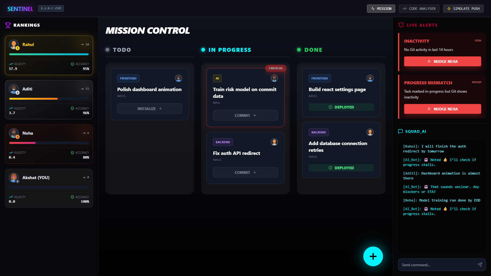
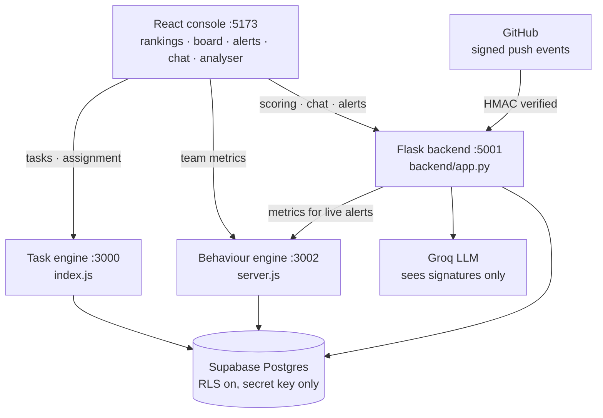
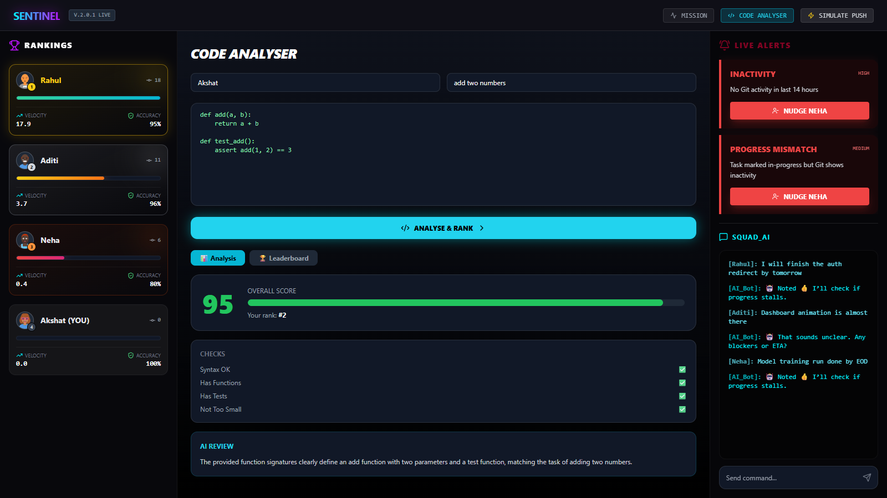
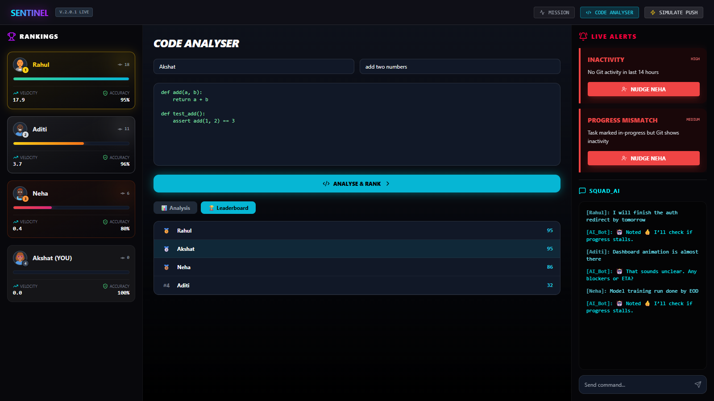
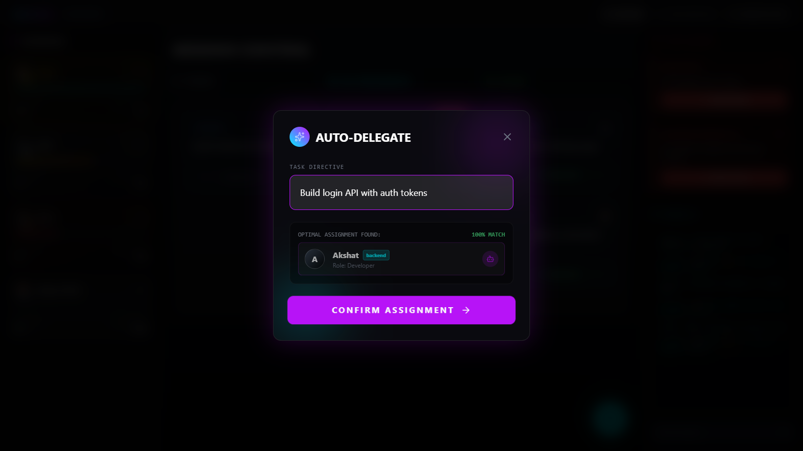

# Sentinel

A developer productivity platform that scores code against a task, compares
stated progress with Git activity, and routes tickets to whoever fits them.

A React console sits over three small services that share one Supabase Postgres
database. Most "developer analytics" tools count commits, which rewards noise.
Sentinel asks two harder questions: **does this submission fit the task**, and
**does the ticket's status match what Git shows?**

The people and activity in these screenshots are sample data from
[`supabase/seed_demo.py`](supabase/seed_demo.py). The assignments, alerts and
scores are computed by the running services, not typed in.



---

## What testing found

The build was tested through its real UI and APIs, which turned up problems that
reading the code didn't.

| Finding | Evidence |
|---|---|
| **The LLM score was close to random.** It saw only signatures, then penalised code for "missing implementation". | The same input scored 0, 70, 30, 0, 50 and 0. After telling the model that bodies are withheld and giving it a scoring guide, matching code scores 90 and unrelated code scores 0 when it responds. |
| **A "CORS error" was really a threading bug.** Flask's debug page hid a crash, and that page has no CORS headers. | 14 of 48 concurrent requests failed with `httpx.ReadError` on a shared HTTP/2 connection. On HTTP/1.1, 0 of 96 failed. |
| **Groq intermittently rejects valid requests.** It returns `json_validate_failed` with an empty reply. | Roughly 3 of 5 calls in one run. With retries, 2 of 48 still fall back to the neutral score. |
| **The dashboard's scroll logic was cutting off the page.** `scrollIntoView` also scrolled the fixed panels on every refresh. | Now only the chat box scrolls, measured at 1600×950 and 1280×620. |
| **The database lockout works.** Row-level security is on with no public policies. | With the public key, the app sees no users at all. |

---

## Architecture



The database is what makes this one product rather than three demos. One service
creates a user, another ranks them, and a third raises alerts about them, because
they all read the same tables. The browser never connects to the database, so
its keys stay on the server.

---

## How code gets scored

A submission gets a weighted composite, and the model is only one term:

```python
final_score = 0.2 * syntax_score    # ast.parse(): it parses or it doesn't
            + 0.3 * quality_score   # has functions, isn't a stub, has tests
            + 0.5 * llm_score       # a Groq-hosted model judging fit to the task
```

- **The LLM sees a summary, not the source.** Signatures and length are extracted
  first, and only those are sent. The database stores the same summary and the
  score, never the code.
- **The trade-off is stated.** The model judges whether the signatures fit the
  task, not whether the code behaves correctly. Well-named broken code can score
  well on that term.
- **It degrades instead of failing.** After four attempts, a failed call returns a
  neutral 60 and says so in the review text.

<table>
<tr>
<td width="50%"></td>
<td width="50%"></td>
</tr>
<tr>
<td align="center"><em>Each check, with the model's reasoning</em></td>
<td align="center"><em>Rankings are computed from stored scores on each read</em></td>
</tr>
</table>

---

## Task routing



The task engine infers required skills from the title, then scores each person on
`matched skills ÷ required skills`. The highest score wins, and ties go to whoever
has **fewer open tasks**, so the strongest person doesn't quietly become the
bottleneck. Below a 0.5 match, the task stays unassigned rather than going to a
poor fit. The suggestion appears before anything is saved.

---

## Behaviour and alerts

Git activity becomes signals rather than raw counts:

| Metric | Definition |
|---|---|
| `staleness` | Hours since the last commit |
| `speed` | Commits ÷ hours inactive |
| `accuracy` | 1 − (reverts ÷ total file edits), so churn doesn't read as productivity |
| `mismatch` | Task is in progress, but no commit for 4+ hours |
| `riskScore` | Staleness band weighted by inaccuracy |

[`alert_engine.py`](backend/alert_engine.py) is a pure function over those signals:

- **`INACTIVITY`**: no Git activity for 12+ hours
- **`DEADLINE_RISK`**: under 24 hours to the deadline, with low activity
- **`PROGRESS_MISMATCH`**: the ticket says in progress, Git says otherwise

The GitHub webhook feeds this with real pushes. It rejects anything without a
valid HMAC signature, records the commit, and scores each changed `.py` file.

---

## Why these technologies

| Choice | Why it fits |
|---|---|
| **React** | Rankings, board, alerts and chat all update from one refresh, and components keep them in step |
| **Flask** | Scoring relies on Python's `ast` and `radon`, and Flask adds only a thin layer of routes |
| **Express** | Behaviour and routing are simple JSON services |
| **Supabase Postgres** | The data is relational, and foreign keys and check constraints enforce the rules even if the code has a bug |
| **Groq** | Hosted open-weight models with a free tier and no GPU needed |
| **Rules for chat** | The vocabulary is small and closed, so a keyword list is cheaper and more predictable than a model |

---

## Running it

```bash
# 0. Setup
cp .env.example .env                    # add your Supabase and Groq keys
npm install
(cd frontend && npm install)
pip install -r backend/requirements.txt
# In a new Supabase project, run supabase/schema.sql once in the SQL editor

# 1. Start each service in its own terminal
(cd backend && python app.py)           # :5001
node server.js                          # :3002
node index.js                           # :3000
(cd frontend && npm run dev)            # :5173

# 2. Optional: fill an empty database with sample data
python supabase/seed_demo.py
```

Then open http://localhost:5173.

---

## API

**Flask · :5001**

| Method | Route | |
|---|---|---|
| `GET` | `/health` | Liveness |
| `POST` | `/analyze` | Score a submission without saving it |
| `POST` | `/analyze-and-rank` | Score, save, and return the leaderboard |
| `GET` | `/alerts/live` | Alerts across every open assigned task |
| `POST` | `/alerts` | Alerts for one behaviour and task state |
| `POST` | `/leaderboard` | Blend `users_behavior` and `users_code_score` from the request |
| `POST` | `/bug-heatmap` | Cyclomatic complexity per function |
| `POST` | `/auto-refactor` | AST-rewritten source |
| `POST` | `/chat/send` | Post a message and get a bot reply |
| `GET` | `/chat/messages`, `/chat/commitments` | History and recorded commitments |
| `POST` | `/github-webhook` | Signed push event |

**Behaviour engine · :3002**: `GET /team`, `GET /behavior/:userId`, `POST /git/update/:userId`, `GET /leaderboard`, `GET /health`, `GET /info`

**Task engine · :3000**: `GET /tasks`, `POST /tasks/suggest`, `POST /tasks/create`, `POST /tasks/assign`, `PATCH /tasks/:id`, `GET /users`, `POST /users/create`

---

## Repository layout

```
backend/
  app.py                 Flask routes
  db.py                  Shared Supabase client
  chat.py, bot.py        Chat storage and message classification
  alert_engine.py        Pure alert rules
  github_events.py       Webhook signature, file fetch, commit recording
  ai_features.py         Complexity heatmap and auto-refactor
  services/code_analysis/  Syntax, quality, summary, LLM and scoring
server.js                Behaviour engine
index.js                 Task engine
db.js                    Shared Supabase client for both engines
frontend/src/            React console
supabase/schema.sql      Tables, view and row-level security
supabase/seed_demo.py    Sample data, created through the APIs
```

---

## Known limitations

Stated here rather than discovered later:

- **No real authentication.** The first screen saves a name and skills, and anyone
  can use any name. Squad codes are generated on screen but not stored or checked.
- **Not ready to deploy.** The services have no access control and run on
  development servers, so they're for local use as they stand.
- **Scoring judges fit, not behaviour.** Running tests in a sandbox would be the
  real fix.
- **Names and IDs are mixed.** Submissions and chat store a display name, while
  tasks and behaviour use a user ID, so renaming someone splits their history.
- **Commit counting isn't atomic.** The webhook reads, adds one and writes, so two
  simultaneous pushes can lose a count.
- **`activity` is a running total.** It's `commits ÷ 24`, not a true 24-hour window.
- **Python only.** Syntax checks, complexity and refactoring all use Python tools.
- **SIMULATE PUSH writes demo data.** Real activity comes through the webhook.

---

**Stack**: `Python` · `Flask` · `Node.js` · `Express` · `React` · `Vite` ·
`TailwindCSS` · `Supabase` · `PostgreSQL` · `Groq` · `radon` · `ast`
