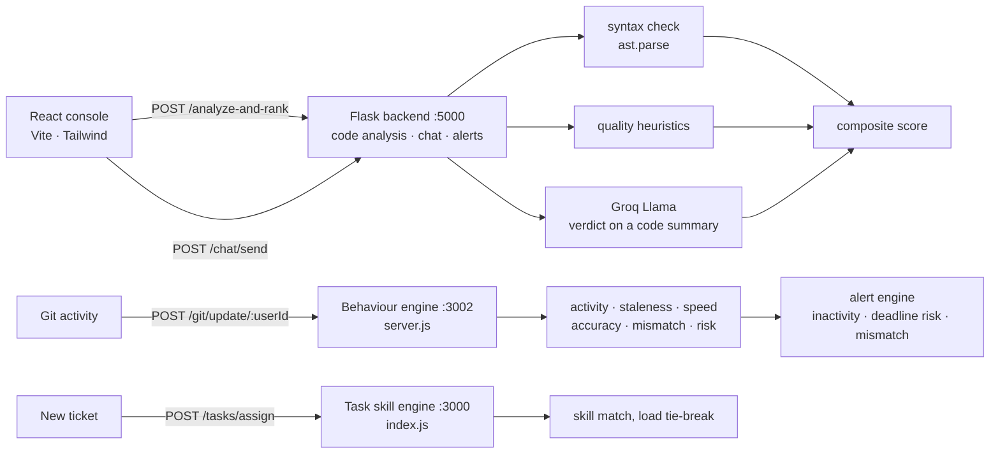

# Sentinel

A developer productivity platform that scores code submissions, profiles
contributors from Git telemetry, and routes tasks to whoever actually fits them.

Three services behind one React console: a Python analysis backend, a
behaviour engine that turns commit activity into metrics, and a
task-assignment engine that matches tickets to people by skill and current
load.

---

## The idea

Most "developer analytics" tools count commits and call it productivity. That
rewards noise. Sentinel tries to measure two things that are harder to fake —
**whether the code submitted actually does the task**, and **whether stated
progress matches observed Git activity** — then uses those signals to route
work and raise alerts before a deadline slips.

---

## Architecture



| Service | Runtime | Port | Responsibility |
|---|---|---|---|
| `backend/` | Python · Flask | 5000 | Code scoring, chat bot, alert engine, complexity heatmap, auto-refactor |
| `server.js` | Node · Express | 3002 | Behaviour engine — Git telemetry to per-user metrics, persisted to `behavior.json` |
| `index.js` | Node · Express | 3000 | Task skill engine — creates tasks, assigns them by skill match |
| `frontend/` | React · Vite · Tailwind | 5173 | Mission console and code analyser |

---

## How code gets scored

The part worth reading. A submission is scored by a weighted composite, and the
model is only one of the three terms:

```python
final_score = 0.2 * syntax_score    # ast.parse() — it either parses or it doesn't
            + 0.3 * quality_score   # structural heuristics
            + 0.5 * llm_score       # a Groq-hosted Llama model judging code against the task
```

- **Syntax** is binary and deterministic — `ast.parse()` succeeds or returns the
  error. No model involved.
- **Quality** is three structural checks: does it define functions (40), is it
  more than a stub (30), does it contain tests (30).
- **The LLM sees a summary, not the source.** Function signatures, class
  signatures and length are extracted first, and only that goes to the model —
  cheaper, and the full submission never leaves the machine.
- **It degrades instead of failing.** Any error in the LLM call — missing key,
  rate limit, unparseable response — returns a neutral 60 with
  `"LLM unavailable - fallback mode"`, so the deterministic 50% still produces a
  usable score. The service never hard-fails because a model was unreachable.
- **Inference runs on Groq**, which serves open-weight models (Llama 3.1 here)
  on its own LPU hardware — no local GPU needed, and free within Groq's rate
  limits, which matters for a side project run on demand rather than kept
  always warm.

---

## The other engines

### Behaviour metrics — `server.js`

Git telemetry per user, turned into signals rather than raw counts:

| Metric | Definition |
|---|---|
| `activity` | commits ÷ 24 |
| `staleness` | hours since last commit |
| `speed` | commits ÷ hours inactive |
| `accuracy` | 1 − (reverts ÷ total file edits) |
| `mismatch` | task is `in_progress` but no commit for 4h+ |
| `riskScore` | staleness band weighted by inaccuracy |

`accuracy` is the interesting one: it treats reverts as a negative signal, so
churning the same file repeatedly doesn't read as productivity.

### Alerts — `backend/alert_engine.py`

A pure function over `(user, behavior, task)` — no I/O, no state, so it's
trivially testable:

- **`INACTIVITY`** — no Git activity for 12h+
- **`DEADLINE_RISK`** — under 24h to deadline with activity below threshold
- **`PROGRESS_MISMATCH`** — ticket says in-progress, Git says otherwise

### Task routing — `index.js`

Assignment scores each candidate on `matched skills ÷ required skills`. Highest
score wins; ties break toward whoever holds **fewer current tasks**, so the
strongest match doesn't silently become the bottleneck. Below a 0.5 match the
task stays unassigned rather than going to a poor fit.

### Chat nudges — `backend/bot.py`

A rule-based classifier over standup messages. "almost", "soon", "trying" mark a
message **vague**; "by EOD", "tonight", "will finish" mark it a **commitment**,
which gets recorded and checked against later activity. Vague updates get a
prompt for a blocker or an ETA. Deliberately not a language model — the
vocabulary is small, closed, and a regex is both cheaper and predictable.

### Complexity heatmap and auto-refactor — `backend/ai_features.py`

- **Heatmap** runs `radon`'s cyclomatic complexity per function and buckets it
  into low / medium / high (McCabe ≥ 10 is high), pointing at the functions most
  likely to hide bugs.
- **Auto-refactor** is an `ast.NodeTransformer` that rewrites
  `for i in range(len(arr))` into `for item in arr` and unparses the tree back to
  source — an AST rewrite, not a string substitution, so it can't corrupt
  surrounding code.

---

## Running it

```bash
# 1. Flask backend  (:5000)
cd backend
pip install flask flask-cors python-dotenv groq radon
echo "GROQ_API_KEY=gsk_..." > .env      # free at console.groq.com — scoring degrades without it
python app.py

# 2. Behaviour engine  (:3002)
npm install
node server.js

# 3. Task skill engine  (:3000)
node index.js

# 4. Frontend  (:5173)
cd frontend
npm install
npm run dev
```

The console talks to the Flask service. The two Express engines are exercised
directly over HTTP:

```bash
curl -X POST localhost:3002/git/update/user1 \
     -H 'Content-Type: application/json' \
     -d '{"commits":7,"fileEdits":{"total":12,"reverts":1}}'

curl localhost:3002/behavior/user1?taskStatus=in_progress

curl -X POST localhost:3000/tasks/create \
     -H 'Content-Type: application/json' \
     -d '{"title":"Fix auth redirect","requiredSkills":["backend","node"],"deadline":"2026-01-01"}'
```

---

## API

**Flask · :5000**

| Method | Route | |
|---|---|---|
| `GET` | `/health` | Liveness |
| `POST` | `/analyze` | Score a submission against a task |
| `POST` | `/analyze-and-rank` | Score, then update and return the leaderboard |
| `POST` | `/alerts` | Alerts for a user's behaviour and task state |
| `POST` | `/bug-heatmap` | Cyclomatic complexity per function |
| `POST` | `/auto-refactor` | AST-rewritten source |
| `POST` | `/chat/send` | Post a message, get a bot reply |
| `GET` | `/chat/messages` · `/chat/commitments` | History and recorded commitments |
| `POST` | `/github-webhook` | Push-event receiver *(see limitations)* |

**Behaviour engine · :3002** — `GET /behavior/:userId`, `POST /git/update/:userId`, `GET /leaderboard`, `GET /health`, `GET /info`

**Task engine · :3000** — `POST /tasks/create`, `POST /tasks/assign`, `POST /users/create`

---

## Known limitations

Stated here rather than discovered later:

- **State is in memory.** Chat history, commitments and the analysis leaderboard
  reset when the Flask process restarts. Only the behaviour engine persists, to
  a local `behavior.json`. There is no database.
- **The GitHub webhook is a stub.** It receives push events and reads commit
  messages, but substitutes placeholder content instead of fetching the actual
  diff, so commits aren't really scored yet. Wiring it to the contents API is the
  obvious next step.
- **The three services aren't integrated with each other.** The React console
  calls the Flask backend only; the behaviour and task engines run standalone
  and are exercised over HTTP. Unifying them behind one gateway is the next
  piece of work.
- **`POST /leaderboard` on the Flask service is broken** — it passes one
  argument to a function that takes two, so the route raises. Use
  `/analyze-and-rank`, which maintains its own ranking correctly.
- **Quality heuristics are shallow by design** — `"def "` and `"test_"` substring
  checks. They're a fast first pass, not static analysis.
- **Python-only.** Syntax checking, complexity and refactoring all use Python's
  `ast` and `radon`.

---

**Stack** — `Python` · `Flask` · `Node.js` · `Express` · `React` · `Vite` ·
`TailwindCSS` · `Groq` · `radon` · `ast`
